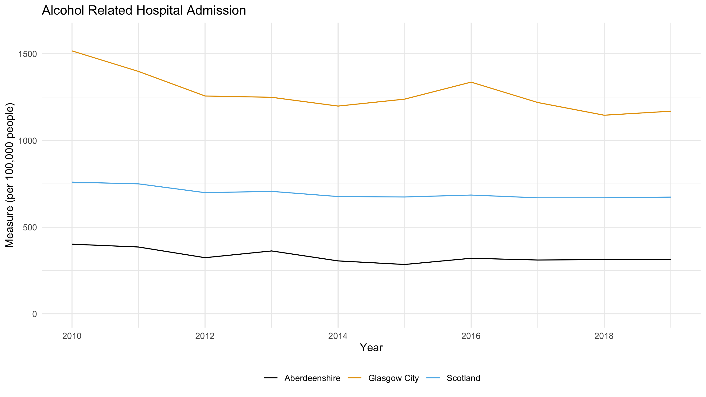

# Introduction
## Data Description

These data come from a **cohort study** of the risk factors for cardiovascular disease. A group of 163 adults, aged between 55 and 75, were examined at the start of the study and a range of *measurements* was taken on each of them. Each row of the dataset is one patient, identified by a unique patient number (patno), and each column is one of those *measurements*. As well as their age in years (age) and sex (sex), the study recorded blood pressure as the usual pair of numbers, systolic and diastolic, in mmHg (systolic, diastolic); body mass index in kg m-2 (bmi); three fats measured in a blood sample, all in mmol l-1, namely total cholesterol, HDL cholesterol and triglyceride (tchol, hdlchol, triglyceride); how many units of alcohol each person drank in the previous week (alcohol); and whether they were a current smoker, an ex-smoker or had never smoked (smoking). The structure of these data is known as a rectangular dataset (aka ‘tidy’ data by the cool kids). Each row is an individual observation, each column a separate variable, and the variable names are contained in the first row of the dataset (aka a header). Unlike the tidy examples in textbooks, though, this dataset is not complete. A few values are missing, and wherever a measurement was not recorded the cell in the file holds NA, which is how R writes a missing value and what it will expect to find when it imports the file. On top of that, at least one value is present but cannot possibly be correct. Tracking down both kinds of problem, the values that are missing and the values that are wrong, is part of your job over this practical and the next.

<!-- Directory Setup -->
```{r setup, echo=FALSE, include=FALSE}
current_dir = getwd()
# current_dir
split_dir = stringr::str_split_1(current_dir, '/')
ifelse(
    split_dir[length(split_dir)] == 'exercises',
    print('Already in exercises'),
    setwd('exercises')
)
rm(current_dir)
rm(split_dir)
```

## Importing Data
```{r import}
cardiac = read.table(
    'data/cardiacdata.txt',
    header = TRUE,
    sep ='\t',
    stringsAsFactors = TRUE
)

cardiac$fsex = factor(cardiac$sex,
              levels = c(1, 2),
              labels = c('Female', 'Male'))

cardiac$fsmoking = factor(cardiac$smoking,
              levels = c(1, 2, 3),
              labels = c('Current', 'Ex', 'Never'))
```


## Data Validation
<!-- Q6a & 9 -->
There are `r nrow(cardiac)` rows of data (patient records). A quick overview of the demography of the records, the average age in the sample is
`r round(mean(cardiac$age), 1)` with the minimum age `r round(min(cardiac$age))` and maximum age `r round(max(cardiac$age))`.

<!-- Q6b -->
```{r validation}
cardiac$bmi[cardiac$bmi > 100] = NA
cardiac$hdlchol[cardiac$hdlchol == 0] = NA
cardiac$triglyceride[cardiac$triglyceride == 0] = NA
```
<!-- Q6c -->
Each of the validations (cleaning) done here are due to a few reasons:

- BMI greater than 100 is impossible so it is set to `NA`
- HDL cholesterol levels at 0 is impossible so it is set to `NA`
- triglyceride levels at 0 is impossible so it is set to `NA`

These rows are not deleted as they are probably just input errors and the rest of the data are still valid

<!-- Q6d -->
```{r alcohol-transform}
cardiac$alcohol_norm = sqrt(cardiac$alcohol)
hist(
    cardiac$alcohol,
    xlab = 'Alcohol Consumption',
    main = 'Histogram of Alcohol Consumption'
)
```
The histogram on the variable alcohol consumption shows it to be extremely right skewed. I applied
a normalisation method by taking its square root to suppress the skew.

```{r alcohol-sqrt}
hist(
    cardiac$alcohol_norm,
    xlab = 'Alcohol Consumption (sqrt)',
    main = 'Histogram of Alcohol Consumption Normalised'
)
```
The normalised value of the alcohol consumption is not as skewed as the original value.


<!-- Q7 -->
```{r chol-plot, fig.cap = 'HDL cholesterol by smoking status', fig.width=8, warning=FALSE}
library(ggplot2)
ggplot(
    data = cardiac, # subset(cardiac, !is.na(fsmoking) & !is.na(hdlchol)),
    mapping = aes(
        x = fsmoking, y=hdlchol
    )) +
    geom_boxplot() +
    labs(
        title = 'HDL Cholesterol for each Smoker Status',
        x = 'Smoking Status',
        y = 'HDL Cholesterol'
    )
```
The boxplots show that there is a box for NA smoking status but this is left alone for transparency.

<!-- Q8 -->
```{r summary-table}
agg_df_cols = c('age', 'systolic', 'tchol')
smoke_summary = aggregate(
    cardiac[agg_df_cols],
    by = list(cardiac$fsmoking),
    FUN = mean,
    na.rm = TRUE
)
knitr::kable(
    smoke_summary,
    digits = 1,
    caption = 'Average of Age, Systolic, Total Cholesterol by Smoker Status'
)
```

<!-- Q11 HTML style image attach -->

The chart above shows hospital admission due to alcohol related issues. Glasgow City appears to have far more alcohol related admissions
compared to Aberdeenshire. While Scotland as a whole just sits in between Aberdeenshire and Glasgow City.
```{r image-via-r, out.width='50%', fig.cap='Alcohol Related Hospital Admission', echo=FALSE, include=FALSE}

```

<!-- Q12 -->
## Session Information
```{r, echo=FALSE}
sessionInfo()
```
