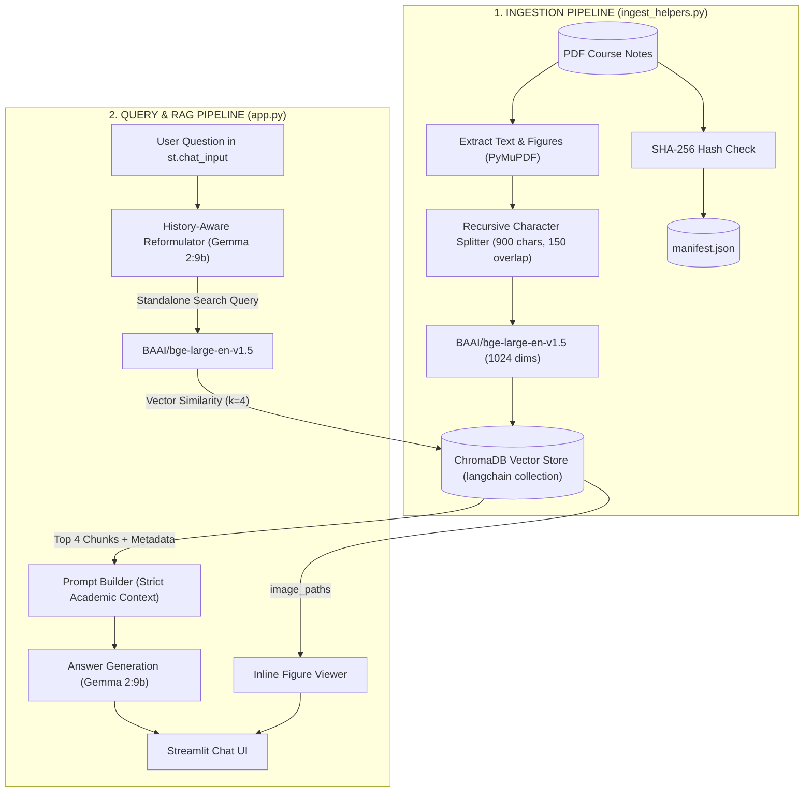

# 📚 Uni QnA: University Notes Assistant

A local Retrieval-Augmented Generation (RAG) assistant built with **Streamlit**, **LangChain**, **ChromaDB**, and **Ollama (Gemma 2:9b)** to index, search, and answer questions across university lecture notes; Currently only supports a very structured PDF doc. No implementation of OCR, the PDF is expected to have machine readable text (Ideally generated by latex, but should work for most PDFs) and images in the PDF have to exist locally as well. The PDF should be in the base directory of each courses within the term-`n` directory while the images in the PDF should be in the `images/` directory wherever the PDF is in. Furthermore, the image needs to be labeled with the figure tag the same as the image name (stem).

---

## Architecture Overview



---

## Key Features

- **100% Local Inference**: Runs entirely locally via Ollama (`gemma2:9b`) and local HuggingFace embeddings (`BAAI/bge-large-en-v1.5`), ensuring academic documents and notes stay completely private.
> For reference I'm running on a Macbook M3 Pro with 18GB RAM
- **Smart Change Detection**: Tracks SHA-256 hashes of indexed files in `manifest.json`. Unmodified files are skipped automatically to prevent redundant re-indexing.
- **Figure & Diagram Linking**: Scans text for LaTeX/Markdown figure references (`\label{fig:...}` or `fig:...`) and maps them to images in the course's `images/` directory, rendering figures directly beneath the AI's explanation.
- **Deterministic Chunk IDs**: Chunks are tagged with `f"{doc_name}#chunk_{idx}"` and purged prior to re-indexing to ensure vectorstore consistency.
- **Context-Aware Follow-ups**: Employs a history-aware query reformulator that uses Gemma 2 to resolve pronouns and conversational references into standalone vector search queries.
- **Strict Academic Grounding**: Configured with a system prompt that mandates strict adherence to retrieved lecture context, explicit citation of document names and page numbers, and refusal to hallucinate external facts.
- **Sidebar Management Dashboard**:
  - Auto-discovers PDFs in course folders.
  - Lists currently indexed documents from `manifest.json`.
  - Enables selective document purging from ChromaDB and the manifest with immediate cache clearing and UI refresh.
- **Audit Logging**: Saves all user queries, model responses, and retrieved source chunks with metadata to `chat_history.jsonl`.

---

## Detailed Workflow Breakdown

### Phase 1: Ingestion & Indexing (`ingest_helpers.py`)

When you select a PDF in the sidebar and click **Index Selected PDFs**:

1. **SHA-256 Hash Verification (`calculate_file_hash`)**:
   - The PDF is read in 8KB chunks and hashed with SHA-256.
   - It checks `manifest.json`. If the file path exists with an identical hash, `parse_pdf` exits early with status `skipped`.

2. **Stale Vector Purge (Idempotency)**:
   - If the file is new or modified, ChromaDB purges existing vectors for that document:
     ```python
     vectorstore.delete(where={"doc_name": doc_name})
     ```
   - This prevents duplicate chunks when you re-index updated lecture notes.

3. **Page Extraction & Figure Matching (`extract_page_images_by_label`)**:
   - PyMuPDF (`fitz`) reads each page text.
   - It checks for figure label patterns (`\label{fig:<name>}` or `fig:<name>`).
   - If matching image files exist in the course's `images/` directory, their paths are stored as JSON strings in the chunk metadata:
     ```python
     metadata = {
         "course_name": course_name,
         "doc_name": doc_name,
         "page_number": page_idx + 1,
         "image_paths": json.dumps(page_image_paths) if page_image_paths else "[]",
     }
     ```

4. **Chunking & Embedding Generation**:
   - `RecursiveCharacterTextSplitter` divides text using chunk size `900` and overlap `150` across separators `["\n\n", "\n", " ", ""]`.
   - Each chunk receives a deterministic unique ID: `f"{doc_name}#chunk_{idx}"`.
   - Dense 1024-dimensional embeddings are generated with `BAAI/bge-large-en-v1.5` and committed to the Chroma persistent collection at `chroma_db/`.
   - The file hash is recorded in `manifest.json`.

---

### Phase 2: Document Management on the Sidebar (`app.py`)

- **Scanner**: Walks the project directory (excluding `.venv`, `.git`, `uni-qna`, and cache folders) to locate PDF files.
- **Indexed Document Listing**: Reads `manifest.json` via `load_manifest()` and renders all indexed notes with course-relative paths.
- **Document Purging (`purge_file`)**:
  - Allows selecting any indexed note from a dropdown.
  - Deletes all chunks matching `where={"doc_name": doc_name}` from ChromaDB.
  - Removes the file key from `manifest.json`.
  - Clears Streamlit's `@st.cache_resource` and triggers `st.rerun()`.

---

### Phase 3: The Query & RAG Inference Lifecycle (`app.py`)

When you submit a question in the chat input, the pipeline executes in two distinct LLM stages:

```
[User Question + Chat History]
               │
               ▼
┌────────────────────────────────────────────────────────┐
│ Stage 1: History-Aware Query Reformulation              │
│ (create_history_aware_retriever + Gemma 2:9b)          │
└────────────────────────────────────────────────────────┘
               │
               ▼ Standalone Search Query
┌────────────────────────────────────────────────────────┐
│ Stage 2: ChromaDB Similarity Search                    │
│ (BAAI/bge-large-en-v1.5 embedding, k=4 nearest chunks) │
└────────────────────────────────────────────────────────┘
               │
               ▼ Top 4 Context Chunks + Image Metadata
┌────────────────────────────────────────────────────────┐
│ Stage 3: Grounded Academic Synthesis                   │
│ (create_stuff_documents_chain + Gemma 2:9b)            │
└────────────────────────────────────────────────────────┘
               │
               ▼
[Streamlit UI Display: Cited Answer + Inline Figures + Source Expander]
```

#### 1. History-Aware Reformulation
- **Problem**: In multi-turn dialogue, users ask follow-up questions with pronouns (e.g., *"What is its formula?"* after asking about standard deviation). Passing that raw query to vector search produces irrelevant results.
- **Solution**: `create_history_aware_retriever` passes the conversation history and the latest query to Gemma 2, prompting it to output an unambiguous, self-contained standalone search query before running retrieval.

#### 2. Vector Retrieval
- The standalone query is converted into a 1024-dimensional vector using `BAAI/bge-large-en-v1.5`.
- ChromaDB performs cosine similarity search and returns the top 4 most relevant chunks (`k=4`) with their associated document names, page numbers, and linked image paths.

#### 3. Strict Academic QA Synthesis
- The retrieved chunks are formatted into the `{context}` variable of the prompt.
- Gemma 2 receives strict instructions:
  - Answer using **ONLY** the provided context.
  - If the answer cannot be found, respond with *"I couldn't find it in your notes"*.
  - Cite the document name and page number for every claim.

---

### Phase 4: UI Rendering & Persistence (`app.py`)

1. **Inline Figure Rendering**:
   - Any figure paths extracted from chunk metadata are validated against the filesystem.
   - If present, diagrams are rendered inline directly below the model's text response with `st.image`.

2. **Transparent Evidence**:
   - A collapsible `st.expander("🔍 View Retrieved Passages")` displays each retrieved text chunk alongside its source document and page number.

3. **Multi-Turn Conversation**:
   - `st.session_state.messages` preserves the conversation history across interactions.

4. **Interaction Logging**:
   - `log_interaction` writes a JSON record of every exchange (timestamp, user question, AI answer, and source metadata) to `chat_history.jsonl`.

---

## Project Structure

```
uni-qna/
├── app.py                 # Streamlit UI & conversational RAG pipeline
├── ingest_helpers.py      # PDF parsing, hashing, chunking, and ChromaDB management
├── __init__.py            # Base paths and environment defaults
├── manifest.json          # File hash tracker for indexed documents
├── chat_history.jsonl     # Append-only interaction log
├── chroma_db/             # Local Chroma vector database directory
└── README.md              # Documentation and system architecture
```

---

## Setup & Running Instructions

### 1. Prerequisites
- **Python 3.12+**
- **Ollama** installed with `gemma2:9b`:
  ```bash
  ollama pull gemma2:9b
  ollama serve
  ```

### 2. Environment Setup
Install dependencies:
```bash
pip install streamlit langchain langchain-chroma langchain-huggingface langchain-ollama langchain-classic langchain-text-splitters pymupdf
```

### 3. Launching the Assistant
From the root workspace or `uni-qna` directory:
```bash
# If inside uni-qna/
streamlit run app.py

# If at repository root
streamlit run uni-qna/app.py
```
Open your browser at `http://localhost:8501`.
